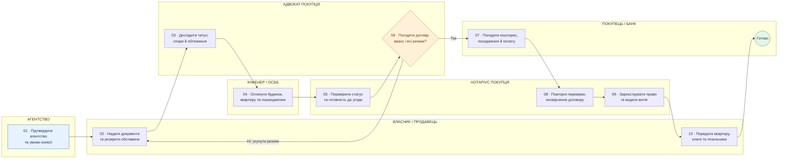
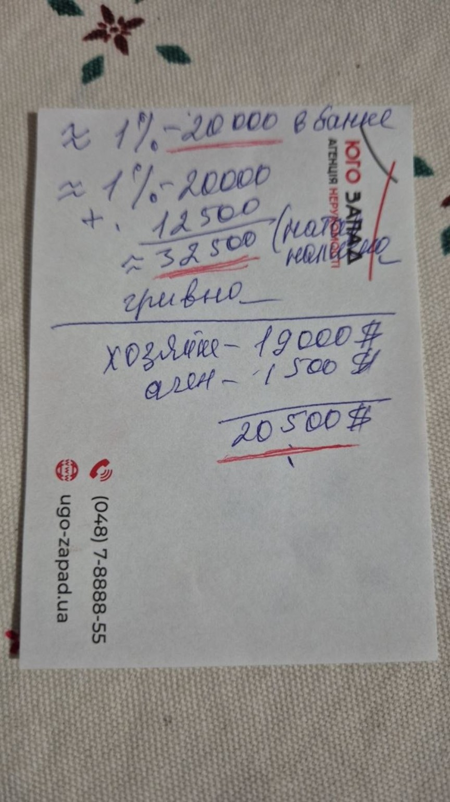

# Купівля квартири в Одеській області — перевірка та оформлення

> Робоча процедура для **готової квартири на вторинному ринку** (Україна, листопад 2026). Не застосовувати без адаптації до майнових прав на недобудову, іпотечних схем, продажу юридичною особою чи спеціальних обмежень. Процедура не замінює висновку адвоката й нотаріальних перевірок.
>
> **[✅ Відкрийте інтерактивний чекліст прогресу (Issue #1)](https://github.com/antshc/apartment/issues/1).** Відмічайте виконані кроки без редагування README. Відмітка означає отриманий і перевірений результат, а не лише обіцянку.

**Учасники:** покупець (ви), власник/продавець, агентство, **незалежний адвокат покупця**, **обраний покупцем нотаріус**, інженер/представник ОСББ, банк. Один відповідальний за крок; інші можуть надавати матеріали.

**Правила безпеки:** до юридичної перевірки — **жодного авансу**; перед основним договором — письмове погодження ризиків, ціни, повного кошторису й способу розрахунку. Якщо реєстр закритий або даних немає, статус **«не перевірено»**, а не **«чисто»**.

## Процес за учасниками (Mermaid swimlanes)

<!-- Mermaid subgraphs are responsibility lanes; numbering matches the checklist below. -->

> **Діаграма відображає відповідальність, а не обов'язково послідовність усіх зустрічей.** Кроки 03–05 можна виконувати паралельно після збору документів. Остаточні перевірки нотаріуса — безпосередньо перед посвідченням. Порядок здійснення оплати та реєстрації погоджуйте з нотаріусом і банком; самовільно не змінюйте його.

## Покроковий чекліст

Змінюйте `[ ]` на `[x]` у [трекері #1](https://github.com/antshc/apartment/issues/1). Нижче — запитання, докази та критерії закриття.

### 01. Агентство: хто посередник і за що платить покупець

**Відповідальний:** агентство. **Контроль:** покупець + адвокат.

- [ ] Перевірити реєстрацію юридичної особи/ФОП, повноваження агента, хто є клієнтом агентства.
- [ ] Отримати проєкт договору послуг, фіксовану суму або відсоток, платника, підставу та момент оплати.
- [ ] Узгодити правила повернення авансу за послуги та комісії, коли продаж зірвано.

**Запитання:** «На кого ви працюєте? Чи отримуєте комісію з обох сторін? Що саме входить у перевірку? Коли я зобов'язаний платити?»

**Документи:** реквізити ЄДРПОУ/ФОП; договір про послуги; підтвердження уповноваження агентства продавцем (із редагуванням зайвих персональних даних); офіційні платіжні реквізити.

**Перевірити:** [ЄДР юридичних осіб та ФОП](https://usr.minjust.gov.ua/content/free-search).

**Закрито, якщо:** компанія існує, представник уповноважений, умови комісії письмово зрозумілі; немає непогодженої передоплати.

### 02. Продавець: вихідний пакет квартири

**Відповідальний:** власник/усі співвласники. **Контроль:** адвокат.

- [ ] Звірити особу кожного власника та підставу права власності.
- [ ] Отримати техпаспорт, відомості про перепланування, склад власників, подружжя, дітей, зареєстрованих і фактичних мешканців.
- [ ] Отримати стан розрахунків за комунальні послуги й ОСББ/управителя, інформацію про орендарів.
- [ ] З'ясувати історію успадкування, дарування, приватизації, попередніх продажів, іпотек і пошкоджень.

**Запитання:** «Як і коли отримано квартиру? Чи набувалася вона в шлюбі? Хто має право жити або користуватися? Чи були спори, оренда, обтяження, перепланування чи пошкодження?»

**Документи:** паспорт/ID та РНОКПП (без зберігання публічно); правовстановлюючий договір/свідоцтво; витяг або інформація з ДРРП; техпаспорт; за потреби документи про шлюб/його припинення, згода подружжя, дозвіл органу опіки, документи співвласників, перепланування; довідки/виписки по платежах.

**Перевірити:** [ДРРП](https://register.minjust.gov.ua/), [Єдина державна електронна система у сфері будівництва](https://e-construction.gov.ua/).

**Закрито, якщо:** документи зібрані, оригінали доступні, невідповідності та відсутні матеріали записані для адвоката.

### 03. Адвокат покупця: незалежний юридичний висновок

**Відповідальний:** **ваш** адвокат, не адвокат агентства.

- [ ] Перевірити юридичний ланцюг набуття права та первинні документи, зокрема БТІ для старих прав.
- [ ] Перевірити власників і частки, арешти, заборони, іпотеки, судові справи, боржників, виконавчі провадження, банкрутство, санкції (наскільки доступно).
- [ ] Окремо проаналізувати майнові права подружжя, спадкоємців, дітей, мешканців, орендарів і ризик оскарження.
- [ ] Отримати **письмовий висновок:** підтверджені факти, ризики, прогалини, потрібні дії та рішення *можна / після умов / не можна*.

**Запитання:** «Хто може оскаржити право? Чи були підозрілі переходи власності? Який ризик не вдалося перевірити? Які документи мають бути до підписання?»

**Документи:** пакет кроку 02; за потреби архівні матеріали БТІ, документи спадкової справи, судові рішення, документи про зняття обтяжень, згода подружжя/органу опіки.

**Перевірити:** [реєстр адвокатів](https://erau.unba.org.ua/), [ДРРП](https://register.minjust.gov.ua/), [судові рішення](https://reyestr.court.gov.ua/), [Єдиний реєстр боржників](https://erb.minjust.gov.ua/), [санкції](https://drs.nsdc.gov.ua/). Пошук обмежений доступністю реєстрів та правилами використання персональних даних.

**Закрито, якщо:** є письмовий позитивний або умовно позитивний висновок; критичні ризики усунені та підтверджені документально.

### 04. Інженер / ОСББ: стан будинку, особливо під час війни

**Відповідальний:** незалежний інженер, дані надають власник та ОСББ/управитель. **Контроль:** покупець.

- [ ] Звірити планування і фактичний стан, мережі, вологість, тріщини, дах/фасад, спільне майно.
- [ ] З'ясувати наслідки обстрілів, вибухової хвилі, пожеж, відновлення несучих конструкцій; чи є акти обстежень.
- [ ] Перевірити великі борги/заплановані збори ОСББ, критичні ремонти, стан ліфтів, укриття, воду, електропостачання.

**Запитання:** «Чи будинок пошкоджувався? Хто і як ремонтував? Чи є рішення ОСББ про великий внесок? Чи безпечні конструкції?»

**Документи:** техпаспорт, акти огляду та ремонту за наявності, протоколи/довідки ОСББ, висновок інженера, акти про воєнні пошкодження та дані про компенсації, якщо застосовно.

**Перевірити:** [ЄДЕССБ](https://e-construction.gov.ua/), [портал відкритих даних](https://data.gov.ua/), ОСББ/управитель та офіційні місцеві джерела. Відсутність публічного запису **не доказ** відсутності пошкодження.

**Закрито, якщо:** технічні ризики оцінено, критичні дефекти відсутні або враховані у рішенні та ціні. Якщо інженера не залучали — зафіксувати усвідомлене рішення.

### 05. Нотаріус покупця: законність майбутньої угоди

**Відповідальний:** обраний покупцем нотаріус. **Контроль:** адвокат.

- [ ] Перевірити свідоцтво, чинний статус, округ/компетенцію та можливість провести угоду за воєнними обмеженнями.
- [ ] Показати оригінали правовстановлюючих документів, перевірити реєстрацію права, обтяження, повноваження й необхідні згоди.
- [ ] Якщо діє довіреність — перевірити її чинність, обсяг повноважень та окремо підтвердити волю власника.
- [ ] Підтвердити документи, яких бракує, порядок платежів та готовність до посвідчення.

**Запитання:** «Які записи реєстрів перевірятимете в день угоди? Чи достатньо документів щодо шлюбу, співвласників, дітей та довіреності? Хто виконує реєстрацію?»

**Документи:** оригінали документів кроку 02, належні згоди/дозволи, довіреність за потреби, документи оцінки та податкові документи за вимогами угоди.

**Перевірити:** [Єдиний реєстр нотаріусів](https://ern.minjust.gov.ua/), [Міністерство юстиції](https://minjust.gov.ua/).

**Закрито, якщо:** нотаріус погодив склад сторін і пакет документів та підтвердив можливість угоди. Попередня перевірка не замінює повторної перевірки в день продажу.

### 06. Адвокат покупця: договір і правило «без авансу до перевірки»

**Відповідальний:** адвокат покупця. **Учасники:** власник, агентство, нотаріус.

- [ ] Вивчити проєкт основного договору: повна справжня ціна, ідентифікація квартири, права користування, зобов'язання продавця, порядок розрахунку та передачі.
- [ ] Переконатися, що вартість і наслідки податків, комісій, нотаріальних послуг розподілені письмово.
- [ ] Якщо потрібен аванс/завдаток — перевірити форму, одержувача, строк, умови повернення, санкції і підтвердження платежу; не підміняти нотаріальний попередній договір «розпискою».
- [ ] Письмово закрити ризики кроків 03–05.

**Запитання:** «За яких умов я гарантовано можу вимагати повернення грошей? Хто платить, якщо угода не відбудеться? Чи всі мешканці звільняють квартиру до передачі?»

**Документи:** проєкт основного договору, за потреби нотаріально посвідчений попередній договір, графік платежів, акт приймання-передачі, письмовий кошторис.

**Перевірити:** [Цивільний кодекс України](https://zakon.rada.gov.ua/laws/show/435-15#Text), адвокатський висновок, письмові роз'яснення обраного нотаріуса.

**Закрито, якщо:** немає невирішених критичних юридичних питань; текст основного договору готовий до підписання.

### 07. Покупець / банк: бюджет і законний розрахунок

**Відповідальний:** покупець; банк забезпечує платіж, нотаріус погоджує порядок оформлення.

- [ ] Письмово звірити всі витрати, їх платника й базу розрахунку; отримати пропозиції нотаріуса й агентства.
- [ ] Підтвердити право на звільнення від 1% пенсійного збору при **першому придбанні житла**, якщо застосовується.
- [ ] За участю банку погодити валюту, рахунки, ліміти, походження коштів, фінмоніторинг, призначення і момент переказу.
- [ ] Перевірити, що продавець правильно визначив свої податки; не погоджувати заниження вартості.

**Запитання:** «Яка повна сума *понад ціну квартири*? Що обов'язкове, а що договірне? Коли платити, що підтвердить одержання?»

**Документи:** деталізований кошторис, документи для звільнення від пенсійного збору (за потреби), оцінка/електронна довідка, банківські реквізити, документи про походження коштів на вимогу банку.

**Орієнтир витрат (перевірити для вашої угоди):**

| Витрата | Загальне правило | Хто несе |
| --- | --- | --- |
| Пенсійний збір | 1% за купівлю нерухомості, є винятки, зокрема перше придбання житла | Зазвичай покупець |
| Держмито за нотаріальну дію | Для відповідних договорів ставка 1%; порядок і застосовність уточнити в нотаріуса | За законом/домовленістю |
| Послуги приватного нотаріуса | Оплата за погодженими тарифами; не додавати автоматично окреме «друге 1%» | За домовленістю |
| Реєстрація права | Адмінзбір за актуальним прожитковим мінімумом/строками, уточнити на дату угоди | За домовленістю |
| Рієлтор | Лише погоджена в договорі комісія; на ринку часто зустрічаються 3–5%, але не державний тариф | За договором |
| Оцінювач, адвокат, інженер, банк | За окремими тарифами/договорами | Замовник або за домовленістю |
| ПДФО/військовий збір з продажу | Залежить від резидентства продавця, строку володіння, спадкування, кількості продажів та чинного законодавства | Податковий обов'язок продавця |

Для звичайного продажу фізособою-резидентом часто діють: **0% ПДФО** за умов пільги (зокрема перший продаж житла за рік після володіння понад три роки або успадкованого житла); **5% ПДФО** без цієї пільги у передбачених випадках; **18% ПДФО** для визначених законом повторних продажів. **Військовий збір** у випадках, де виникає оподатковуваний дохід, за загальним правилом — **5%**; для конкретної угоди нотаріус має перевірити чинні винятки, податкову базу та ставки. Не застосовуйте ці ставки автоматично до нерезидента.

**Перевірити:** [ДПС України](https://tax.gov.ua/), [Пенсійний фонд](https://www.pfu.gov.ua/), [Фонд державного майна — оцінка](https://evaluation.spfu.gov.ua/), [НБУ](https://bank.gov.ua/), [Закон про держреєстрацію прав](https://zakon.rada.gov.ua/laws/show/1952-15#Text).

**Закрито, якщо:** кошторис підписано/погоджено, банк і нотаріус схвалили схему оплати. Готівкові платежі між фізособами за нотаріальними договорами з нерухомістю понад установлену НБУ межу (як правило 50 000 грн) слід проводити безготівково за чинними правилами.

### 08. Нотаріус: підписання основного договору

**Відповідальний:** нотаріус; продавець і покупець підписують, банк проводить погоджений розрахунок.

- [ ] Повторити актуальні перевірки власності, арештів, заборон, повноважень, санкцій та потрібних згод.
- [ ] Прочитати остаточний текст договору й звірити ціну, сторони, адресу, площу, платіж, передачу та заяви продавця.
- [ ] Провести й задокументувати розрахунок за узгодженою з нотаріусом схемою та отримати договір.

**Запитання:** «Чи не змінився стан реєстрів? Чи відповідає підписана версія погодженій? Яким документом підтверджується платіж?»

**Документи:** оригінали, згоди, оцінка, підтвердження податків/платежів, остаточний договір, банківські підтвердження.

**Закрито, якщо:** договір законно посвідчено, умови розрахунку виконані або підконтрольні погодженій захищеній схемі.

### 09. Нотаріус: реєстрація права власності

**Відповідальний:** нотаріус. **Контроль:** покупець + адвокат.

- [ ] Перевірити завершення державної реєстрації на покупця.
- [ ] Отримати договір та інформацію/витяг ДРРП і звірити ПІБ, адресу, частку, площу, обтяження.

**Запитання:** «Чи зареєстровано моє право? Де підтвердження?»

**Документи:** нотаріально посвідчений договір, витяг/відомості з ДРРП.

**Перевірити:** [ДРРП](https://register.minjust.gov.ua/).

**Закрито, якщо:** право зареєстровано правильно, підтвердження отримано.

### 10. Власник і покупець: фактична передача

**Відповідальний:** продавець передає, покупець перевіряє та приймає.

- [ ] Перевірити звільнення квартири, фактичних мешканців, майно за договором, відсутність нових дефектів.
- [ ] Підписати акт приймання-передачі з датою, показниками лічильників і комплектом ключів.
- [ ] Зберегти підтвердження повного розрахунку, передати показники постачальникам, переоформити договори.

**Запитання:** «Усі ключі надані? Хто платить за комунальні послуги до дати передачі? Чи залишився будь-хто у квартирі?»

**Документи:** акт передачі, перелік ключів, показники лічильників, квитанції/звірки.

**Закрито, якщо:** квартира фактично передана й права покупця можна реалізувати без перешкод.

## Стоп-умови

**Не передавати гроші**, якщо невідомий власник/повноваження представника; відмовляються показувати оригінали; не пояснені обтяження; не з'ясовано права подружжя, дітей, співвласників і мешканців; вимагають приховати реальну ціну; наполягають на неперевіреному посереднику чи розрахунку третій особі без правової підстави.

**Особливо перевіряти**, якщо квартира продається за довіреністю, отримана у спадщину, нещодавно кілька разів перепродана, не збігаються площа/план або є ознаки наслідків воєнних пошкоджень. Самі ці ознаки не доводять шахрайства.

**Конфіденційність:** репозиторій може змінити рівень доступу. Не публікувати паспортні дані, РНОКПП, реквізити рахунків, повні скани документів, адресні деталі майбутньої покупки та персональні юридичні висновки. Зберігати їх окремо у захищеному сховищі.

## Офіційні джерела

- [Міністерство юстиції України](https://minjust.gov.ua/) — нотаріат і реєстрація прав.
- [Державна податкова служба](https://tax.gov.ua/) — оподаткування продажу нерухомості, ПДФО та військовий збір.
- [Пенсійний фонд України](https://www.pfu.gov.ua/) — пенсійний збір і пільги при купівлі житла.
- [НБУ](https://bank.gov.ua/) — правила розрахунків і банківські обмеження.
- [Законодавство України](https://zakon.rada.gov.ua/) — чинні нормативні тексти.
- [ЄДР судових рішень](https://reyestr.court.gov.ua/) — судові спори.
- [ЄДЕССБ](https://e-construction.gov.ua/) — відомості про будівництво.

**Підхід:** README — процедура та посилання на джерела; [Issue #1](https://github.com/antshc/apartment/issues/1) — **єдиний чекліст прогресу**.

---

## Пропозиція витрат від агентства — фото записки (20.11.2026)

> Це **дослівне прочитання рукописної нотатки, а не перевірений кошторис чи підтвердження законних тарифів**. Валюти не змішувати. Частину призначень платежів неможливо визначити з фото.

| Що видно на фото | Сума | Ступінь впевненості / питання |
| --- | ---: | --- |
| «≈ 1% — 20 000 в банке» | ≈ 20 000 грн | Сума читається, але **неясно, за що саме банк бере 1%** |
| «≈ 1% — 20 000» | ≈ 20 000 грн | Сума читається, платіж не підписано |
| «+ 12 500» | 12 500 грн | Сума читається, призначення не підписано |
| Підкреслений підсумок «≈ 32 500 гривня» | ≈ 32 500 грн | Арифметично дорівнює 20 000 + 12 500; це **не обов'язково** сума з першим рядком про банк |
| «Хозяину — 19 000 $» | 19 000 USD | Ймовірно виплата продавцю |
| «Агент — 1 500 $» | 1 500 USD | Ймовірно комісія агентства; потрібно уточнити базу та договір |
| Підкреслений доларовий підсумок | **20 500 USD** | 19 000 + 1 500 = 20 500 |

**Можливий загальний гривневий бюджет:** якщо перші 20 000 грн «в банку» — **окремий** платіж понад 32 500 грн, то сума гривневих платежів становить **52 500 грн**. Якщо це повтор того самого платежу — лише **32 500 грн**. **Цей момент обов'язково уточнити письмово.** Разом доларова частина на записці — 20 500 USD, без переведення у гривні.

### Питання, які потрібно поставити агентству / нотаріусу

- [ ] Чи є 20 000 грн «в банку» окремим платежем від 32 500 грн? Від кого, кому, за яку послугу, за яким тарифом?
- [ ] За що беруться другі 20 000 грн (1%) та 12 500 грн? Які з них обов'язкові державні платежі, а які — платні послуги?
- [ ] Яка **договірна ціна квартири у гривнях** і чому 1% дорівнює 20 000 грн, якщо продавцю вказано 19 000 USD?
- [ ] Чи 1 500 USD агенту — остаточна комісія? Який договір/рахунок і коли оплачується?
- [ ] Чи включені пенсійний збір, нотаріус, реєстрація, оцінка, банківські витрати, податки продавця?
- [ ] Чи можливе звільнення від 1% пенсійного збору при першому придбанні житла?
- [ ] Попросити **письмовий кошторис у гривнях** з одержувачем кожного платежу, документом-підставою та умовами повернення.

### Контакт агентства на візитці

На візитівці: агентство **«Юго Запад»**, **Топор Анжела Петрівна**, заступник директора; сайт: `ugo-zapad.ua`; адреса: м. Одеса, пр. Князя Володимира Великого, 112. Контактні номери — на оригінальному фото. **Це дані візитівки, а не підтвердження реєстрації, повноважень чи надійності агентства.** Перевіряти через ЄДР і офіційні договори.

**Оригінали:** [фото кошторису](assets/agency-cost-note.jpg) · [фото візитівки](assets/agency-business-card.jpg). Персональні документи продавця до репозиторію не додавати.
